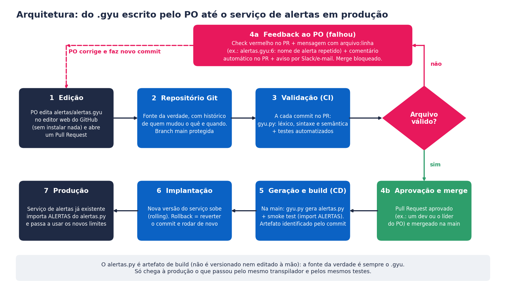

# gyu: transpilador de alertas `.gyu` → Python

O Product Owner escreve alertas em uma linguagem simples (`.gyu`) e o transpilador gera o
Python que o sistema de alertas já existente consome. Sem bibliotecas de parsing: tokenizador,
parser, análise semântica e gerador foram escritos à mão, cada um em seu próprio módulo.

```
alertas.gyu  ──►  tokenizador ─► parser ─► semântica ─► gerador  ──►  alertas.py
(escrito pelo PO)                 (transpilador)                    (Python gerado)
```

Requisitos: **Python 3.8+**, sem dependências externas.

---

## 1. Como rodar

```bash
python gyu.py entrada.gyu -o saida.py
```

| Opção | O que faz |
|---|---|
| `-o saida.py` | arquivo gerado (padrão: mesmo nome da entrada, com `.py`) |
| `--tokens` | imprime os tokens (etapa 1) e continua |
| `--ast` | imprime a AST (etapa 2) e continua |

Código de saída: `0` ok · `1` arquivo `.gyu` inválido · `2` erro de uso/leitura.
Havendo qualquer erro, **nenhum arquivo é gerado** e as mensagens saem no formato
`arquivo:linha: erro <etapa>: mensagem`:

```
$ python gyu.py exemplos/invalido_1_nome_repetido.gyu -o alertas.py
invalido_1_nome_repetido.gyu:6: erro semântico: nome de alerta repetido 'temperatura_sensor' (já declarado na linha 2)
1 erro(s). Nenhum arquivo gerado.
```

### Exemplo completo (o do enunciado)

```bash
python gyu.py exemplos/valido_3_forno.gyu -o alertas.py
python -c "
from alertas import ALERTAS
alerta = ALERTAS[0]
print(alerta.nome)            # temperatura_do_forno
print(alerta.disparou(95))    # True
print(alerta.disparou(50))    # False
"
```

O Python gerado é autocontido (não importa o transpilador), importável e expõe a lista
`ALERTAS` de objetos `Alerta` (`nome`, `minimo`, `maximo`, `disparou(valor)`):

```python
ALERTAS = [
    Alerta(nome='temperatura_sensor', minimo=10, maximo=80),
    Alerta(nome='clima_tempo', maximo=35.5),
]
```

**Semântica de `disparou(valor)`:** `True` quando o valor está *fora* da faixa permitida
(`valor < min` ou `valor > max`). Valor exatamente igual ao limite **não** dispara.

## 2. Como testar

```bash
python -m unittest discover -s tests -v
```

Os testes cobrem cada etapa isoladamente (tokens, AST, as 6 regras semânticas, erros de
sintaxe), o código gerado (importa e chama `disparou`), todos os arquivos de `exemplos/` e o
CLI (códigos de saída e "não gera arquivo quando há erro").

---

## 3. A linguagem `.gyu`

```
# comentário
alert temperatura_sensor;
- min: 10
- max: 80

alert clima_tempo;
- max: 35.5
```

1. Cada alerta começa com `alert nome;`
2. Nome: letras (com ou sem acento), números e `_`, começando por letra, sem espaços.
3. Propriedades, uma por linha: `- chave: valor`
4. Só `min` e `max`, com inteiros ou decimais (inclusive negativos).
5. Linhas em branco são ignoradas; `#` inicia um comentário (até o fim da linha).

Gramática (EBNF):

```
programa    = { alerta } ;
alerta      = "alert" nome ";" FIM_DE_LINHA { propriedade } ;
propriedade = "-" chave ":" número FIM_DE_LINHA ;
número      = [ "-" ] dígito { dígito } [ "." dígito { dígito } ] ;
```

## 4. Estrutura do código

```
gyu.py                      CLI
transpilador/
  tokenizador.py            etapa 1: texto -> tokens (tipo, valor, linha, coluna)
  parser.py  (+ arvore.py)  etapa 2: tokens -> AST (descida recursiva)
  semantica.py              etapa 3: regras de validação
  gerador.py                etapa 5: AST -> código Python
  erros.py                  ErroLexico / ErroSintatico / ErroSemantico
exemplos/                   3 .gyu válidos + 3 inválidos
tests/test_gyu.py           testes (unittest)
docs/                       diagrama da arquitetura (+ script que o gera)
alertas/alertas.gyu         arquivo de alertas "de produção" (o que o PO edita no GitHub)
.github/workflows/          pipeline de validação (GitHub Actions), ver seção 7
```

Mapeamento para o "caminho comum" de compiladores (a etapa 4, transformação/otimização, não é
necessária nesta linguagem, pois a AST vai direto para o gerador):

| # | Etapa | Módulo | Para na 1ª falha? |
|---|---|---|---|
| 1 | Análise léxica | `tokenizador.py` | sim |
| 2 | Análise sintática | `parser.py` | sim |
| 3 | Análise semântica | `semantica.py` | **não**: acumula todos os erros |
| 5 | Geração de código | `gerador.py` | só roda se não houve erro |

### Em qual etapa entra cada validação?

| Problema | Etapa | Por quê |
|---|---|---|
| Caractere invisível (ex.: espaço de largura zero colado do Word) | **Léxica** | não é um símbolo reconhecível |
| Nome ausente (`alert;`) | **Sintática** | falta uma peça da estrutura |
| Nome com espaços (`alert meu alerta;`) | **Sintática** | sobra um token onde se esperava `;` |
| Falta de `;`, `:` ou número; duas propriedades na mesma linha | **Sintática** | forma do arquivo |
| Nome fora do padrão (`1abc`, `temp-sensor`) | **Semântica** | a forma está certa, o *conteúdo* não segue a regra |
| Nome repetido | **Semântica** | exige olhar o programa inteiro (tabela de nomes) |
| Chave estranha (≠ `min`/`max`) | **Semântica** | exige conhecer o vocabulário da linguagem |
| Chave repetida no mesmo alerta | **Semântica** | idem, olhando o alerta inteiro |
| Sem limites (nem `min` nem `max`) | **Semântica** | idem |
| Limites invertidos (`min` > `max`) | **Semântica** | compara valores de duas propriedades |

Decisões de projeto:

* O léxico separa "palavras" em qualquer sequência sem espaço, `;`, `:` ou `#`. Assim, `1abc` e
  `temp-sensor` chegam à semântica como nomes e recebem a mensagem clara "nome inválido", em vez
  de um erro de sintaxe confuso.
* Texto é normalizado para NFC: `é` digitado como `e` + acento combinante (comum no macOS) é aceito.
* `min == max` é permitido (alerta que dispara para qualquer valor diferente).
* Nomes diferenciam maiúsculas de minúsculas (`Temp` e `temp` são alertas distintos).
* Alerta que só tem chave estranha não gera também "sem limites", para evitar erro em cascata.
* A saída é determinística (sem data/hora), então o mesmo `.gyu` gera sempre o mesmo `.py`.

## 5. Exemplos (`exemplos/`)

| Arquivo | Resultado |
|---|---|
| `valido_1_temperatura.gyu` | ok (exemplo do enunciado) |
| `valido_2_negativos_acentos.gyu` | ok: acentos, negativos, decimais, comentários |
| `valido_3_forno.gyu` | ok: `temperatura_do_forno` (95 → `True`, 50 → `False`) |
| `invalido_1_nome_repetido.gyu` | recusado: nome repetido |
| `invalido_2_chave_estranha.gyu` | recusado: chave estranha |
| `invalido_3_limites_invertidos.gyu` | recusado: limites invertidos |

As demais regras (nome inválido, chave repetida, sem limites e os erros de sintaxe) são cobertas
em `tests/test_gyu.py`.

---

## 6. Desafio 2: arquitetura em produção

> Proposta de desenho (nada disso foi implementado nesta entrega, apenas o transpilador).
> Premissa: o código do projeto fica em um repositório Git no GitHub, com GitHub Actions
> disponível, e o serviço de alertas roda em contêiner.



O PO só enxerga um arquivo de texto e uma tela de Pull Request. Tudo o mais é automático.

### Edição: onde o PO escreve e guarda os `.gyu`?
Em `alertas/alertas.gyu` (um arquivo por serviço) no **repositório Git**. O PO edita pelo
**editor web do GitHub** (botão "lápis"): não precisa instalar Python, Git nem IDE. Ao salvar,
escolhe "criar branch e abrir Pull Request". O Git dá de graça histórico (quem mudou o limite,
quando e por quê), revisão e reversão. A `main` é protegida: ninguém altera alerta de produção
sem passar pela validação.
Usar um único arquivo por serviço faz a regra de nome repetido valer para todos os alertas dele.

### Validação contínua: quando o pipeline roda e o que acontece se falhar?
Roda **a cada commit em um Pull Request** (e de novo na `main`). O job do GitHub Actions executa:
1. `python gyu.py alertas/alertas.gyu -o /tmp/alertas.py`, ou seja, léxico, sintaxe e semântica;
2. `python -m unittest discover -s tests`, para garantir que o próprio transpilador continua correto;
3. um *smoke test*: importar o `alertas.py` gerado e conferir que `ALERTAS` não está vazia.

Se qualquer passo falhar (código de saída ≠ 0), o **check do PR fica vermelho e o merge é
bloqueado** (regra de branch protegida). Nada inválido chega à `main`, nem à produção.

### Feedback: como o PO fica sabendo do erro e onde vê a mensagem?
As mensagens do transpilador já vêm no formato `arquivo:linha: erro etapa: mensagem` e em
português, escritas para quem não programa (ex.: `alertas.gyu:6: nome de alerta repetido
'temperatura_sensor' (já declarado na linha 2)`). O pipeline as entrega em três lugares:
* **anotação na linha do arquivo** na aba "Files changed" do PR (via `::error file=...,line=...::`);
* **comentário automático no PR**, com a lista de todos os erros semânticos de uma vez;
* **notificação** por Slack/e-mail para o PO, com o link do PR.

O PO corrige no mesmo editor web, faz novo commit e o pipeline roda de novo.

### Implantação: quando o `.py` é gerado e como chega ao serviço de alertas?
O `alertas.py` **não é versionado nem editado à mão**: é artefato de build. Depois que o PR é
aprovado (por um dev ou pelo líder do PO) e mergeado na `main`, o pipeline de entrega:
1. gera o `alertas.py` com `python gyu.py`;
2. roda o smoke test de novo;
3. empacota o arquivo na imagem do serviço de alertas (tag = hash do commit);
4. publica a nova versão com *rolling deploy*, sem derrubar o serviço.

O serviço existente continua fazendo `from alertas import ALERTAS`: o contrato não muda.
**Rollback:** reverter o commit na `main`, o que regenera e reimplanta a versão anterior.
Em minutos o limite novo está em produção, sem depender de um desenvolvedor.

### Possíveis evoluções
* Um preview no PR mostrando "o que mudou" (ex.: `temperatura_sensor: max 80 → 90`) para a
  revisão ficar fácil para quem não programa.
* Validar também contra o sistema real (ex.: alerta que referencia um sensor inexistente).
* Autoria e auditoria: registrar no deploy quem aprovou cada alteração de limite.

---

## 7. Implementação de referência no GitHub (opcional)

O enunciado pede só o desenho da arquitetura. Para mostrar que ele funciona, o repositório já
traz o essencial do fluxo, pronto para subir ao GitHub:

| Arquivo | Papel no diagrama |
|---|---|
| `alertas/alertas.gyu` | etapa 1: o arquivo que o PO edita |
| `.github/workflows/validar.yml` | etapas 3, 4a e 5: validação, feedback e geração do `alertas.py` |
| `.gitignore` | garante que o `alertas.py` gerado nunca é versionado |

O workflow (`validar.yml`) roda em todo Pull Request e em todo push na `main`:

1. `python -m unittest discover -s tests`: testa o transpilador;
2. `python gyu.py alertas/alertas.gyu -o build/alertas.py`: valida e gera. Se falhar, cada linha de
   erro do transpilador (`arquivo:linha: erro ...: mensagem`) vira uma **anotação na linha do
   arquivo** na aba *Files changed* do PR, e o check fica vermelho;
3. smoke test: importa o `alertas.py` gerado e confere que `ALERTAS` não está vazia;
4. na `main`, guarda o `alertas.py` como **artefato** do build (o ponto de partida do deploy).

### Configuração no GitHub

1. Crie o repositório e suba o conteúdo desta pasta (o `gyu.py` fica na raiz).
2. Aguarde a primeira execução na aba **Actions** (precisa dela para o check `validar` existir).
3. Em **Settings → Rules → Rulesets**, crie uma regra para a branch padrão com: *Require a pull
   request before merging* (1 aprovação), *Require status checks to pass* (`validar`) e
   *Block force pushes*.
4. Em **Settings → Collaborators**, dê permissão *Write* ao PO. Quem aprova o PR deve ser outra pessoa.

### Como demonstrar

1. O PO edita `alertas/alertas.gyu` pelo editor web (ícone de lápis), introduz um erro (por exemplo,
   `min` maior que `max`) e abre o Pull Request.
2. O check `validar` fica vermelho, o merge é bloqueado e o erro aparece na linha do arquivo.
3. O PO corrige e faz novo commit; o check fica verde.
4. Um dev aprova e faz o merge; na `main`, o `alertas.py` fica disponível em
   *Actions → execução → Artifacts → alertas-py*.

A etapa final (copiar o `alertas.py` para o serviço de alertas em produção) depende da infraestrutura
do projeto e fica como evolução: seria um job de deploy a mais nesse mesmo workflow.
